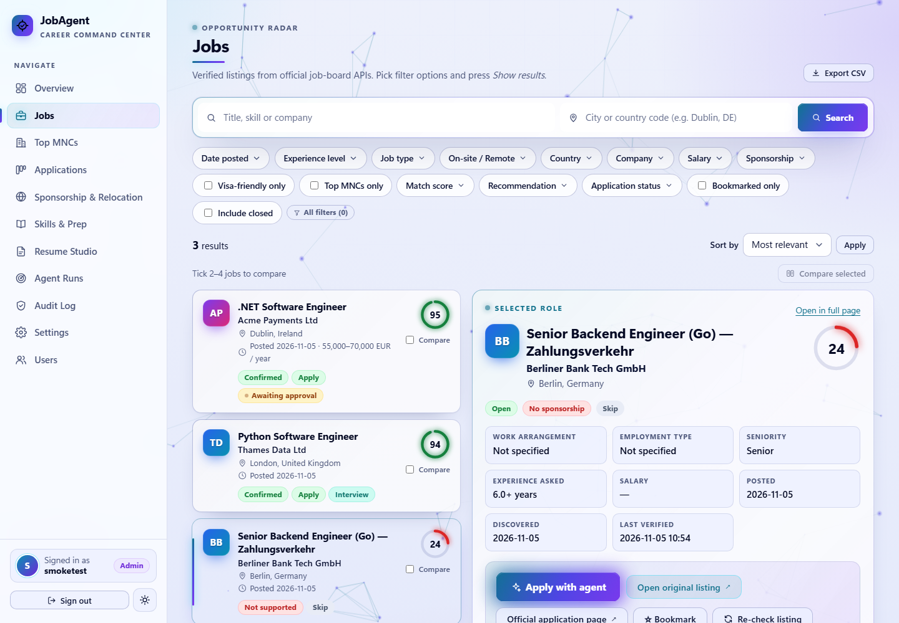
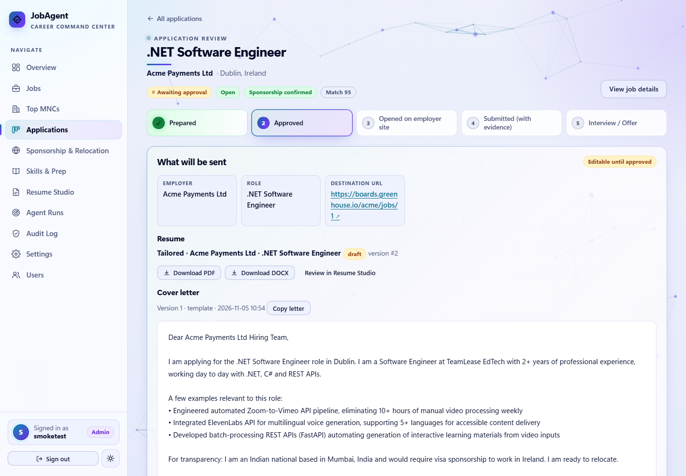
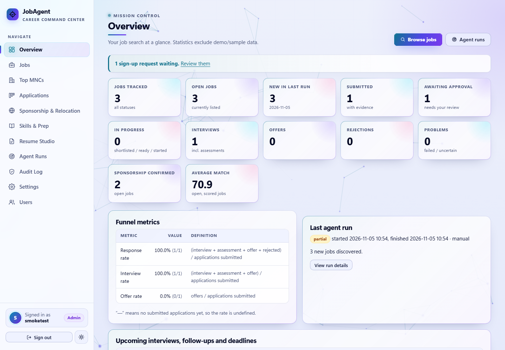
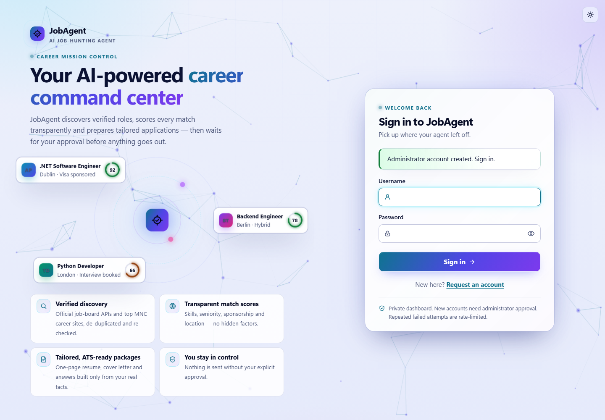

# JobAgent


**Live:** https://jobagent-peach-xi.vercel.app (sign-up requires admin approval)

| Jobs search | Application review |
|---|---|
|  |  |
| **Overview** | **Sign in** |
|  |  |

*Screenshots use synthetic demo data.*

A multi-user, approval-gated job-search agent and dashboard. It discovers software-engineering
jobs from official job-board APIs, deduplicates them permanently, checks sponsorship evidence, scores each
job against your verified resume with an explanation, prepares tailored application packages, and records
every application with evidence. It **never submits an application without your explicit, job-specific
approval**, and the final submit click always happens on the employer's own site.

> Nothing here guarantees sponsorship, interviews or employment. Sponsorship labels are evidence summaries
> with sources and dates; always confirm with the employer and the official immigration authority.

---

## Architecture

```
            ┌───────────────────── FastAPI (jobagent/web) ─────────────────────┐
 Browser ──►│ auth/sessions/CSRF ─ dashboard pages ─ session-protected JSON API  │
            └──────┬──────────────────────┬──────────────────────────┬─────────┘
                   │                      │                          │
          applications.py          agent.py (runs)            resume/ (parser,
          state machine +          discover→dedupe→verify      analysis, variants,
          fingerprinted approvals  →sponsorship→score→prepare  export, store)
                   │                      │
     ┌─────────────┴──────┐   ┌──────────┴────────────┬───────────────┐
     │ db.py (SQLite or    │   │ sources.py (Greenhouse │ ai.py (OpenAI/ │
     │ PostgreSQL, migr-   │   │ Lever, Ashby, Arbeit-  │ Anthropic, budgets,
     │ ations, audit chain,│   │ now APIs) + http.py    │ cache, grounding) │
     │ locks)              │   │ ingest.py / normalize  │ matching.py (rules)│
     └─────────────────────┘   └────────────────────────┴───────────────────┘
```

| Module | Responsibility |
|---|---|
| `jobagent/db.py` | SQLite (local) / PostgreSQL (hosted) wrapper, versioned migrations per dialect, transactions, hash-chained append-only audit log, cross-process run lock, SQLite backup/restore |
| `jobagent/resume/` | Resume discovery + layout-aware parsing (PDF/DOCX/TXT), quality analysis (ATS, metrics, wording, inconsistencies, risky claims), fact-preserving variants, PDF/DOCX export, versioned store |
| `jobagent/sources.py`, `http.py` | Official public job-board APIs only; polite client with pacing, bounded retries, exponential backoff + jitter, `Retry-After` |
| `jobagent/normalize.py`, `ingest.py` | Canonical URLs, employer/title normalisation, location→country, stable job identity, multi-signal deduplication, reposts, closures |
| `jobagent/jd.py`, `sponsorship.py`, `matching.py` | Requirement extraction, sponsorship classification with evidence (incl. UK Home Office sponsor register), transparent weighted scoring with hard disqualifiers |
| `jobagent/applications.py` | Deterministic state machine, fingerprinted single-use approvals, evidence-required submission, uncertain-outcome handling, external applications, manual corrections |
| `jobagent/ai.py` | Provider abstraction, schema validation, verbatim-quote grounding, prompt-injection containment, per-run & monthly budgets, response cache, usage/cost tracking |
| `jobagent/agent.py` | Run orchestration (idempotent, locked, time-boxable for serverless), run records & per-job decisions |
| `jobagent/web/` | Dashboard (Overview, Jobs with LinkedIn-style filters, Applications, Sponsorship, Skills & Prep, Resume Studio, Runs, Audit, Settings) |
| `jobagent/cli.py` | Command-line entry point |

Deterministic code decides duplicates, state transitions, validation and security. AI is optional and only
drafts text or suggests extracted facts, which are kept only if they quote the posting verbatim.

## Prerequisites

* Windows 10/11 (also works on macOS/Linux), Python 3.12+
* Optional: an OpenAI or Anthropic API key (everything works without one)
* For hosting: a Vercel account and a PostgreSQL database (Neon via Vercel Storage works on the free tier)

## Installation (local)

```powershell
cd C:\Users\tledt\source\repos\JobAgent
python -m venv .venv
.venv\Scripts\python -m pip install -r requirements.txt pytest
copy .env.example .env          # then edit .env (secret key, resume path, optional AI key)
.venv\Scripts\python -m jobagent init
.venv\Scripts\python -m jobagent create-user
.venv\Scripts\python -m jobagent import-resume
.venv\Scripts\python -m jobagent serve      # http://127.0.0.1:8765
```

### Environment variables

See `.env.example` (placeholders only). Key ones: `JOBAGENT_SECRET_KEY` (required, 32+ chars),
`JOBAGENT_RESUME_PATH`, `DATABASE_URL` (PostgreSQL; omit for local SQLite), `JOBAGENT_AI_PROVIDER` +
`OPENAI_API_KEY`/`ANTHROPIC_API_KEY`, and for hosting `CRON_SECRET` and `JOBAGENT_SETUP_TOKEN`.
Secrets are read only from the environment/.env, are never stored in the database, and are redacted from run
records and logs.

Multi-user / email variables:

| Variable | Purpose |
|---|---|
| `JOBAGENT_ADMIN_EMAIL` | Receives every new sign-up request (with Approve / Reject links). Falls back to the admin account's email. |
| `JOBAGENT_PUBLIC_URL` | Base URL for links in emails (https only, except `localhost`). On Vercel defaults to the project's production URL; locally falls back to the request URL. Links are omitted if no acceptable URL is known. |
| `RESEND_API_KEY` | Send email through the Resend HTTP API (`https://api.resend.com/emails`). |
| `JOBAGENT_MAIL_FROM` | Sender, default `JobAgent <onboarding@resend.dev>` (Resend's test sender only delivers to your own Resend account address until you verify a domain). |
| `SMTP_HOST`, `SMTP_PORT`, `SMTP_USER`, `SMTP_PASSWORD`, `SMTP_FROM` | Alternative SMTP provider (e.g. Gmail + App Password; port 587 STARTTLS or 465 TLS). Used when `RESEND_API_KEY` is not set. |

With no provider configured, emails are only recorded in the **outbox** shown on the Admin page (sign-ups are
still listed there and can be approved on that page).

### Database & migrations

Migrations live in `jobagent/migrations/sqlite/` and `jobagent/migrations/postgres/` and are applied
automatically (each in a transaction; a failed migration is rolled back). Indexes, foreign keys and unique
constraints enforce one application per user and job identity, one active approval per application, one
canonical resume per user, and unique listings per source. Migration `0004_multiuser` converts an existing
single-user database in place: the existing account becomes the approved administrator and all existing private
rows are assigned to it (SQLite table rebuilds run with foreign keys off and are verified with
`PRAGMA foreign_key_check` before commit).

## Multiple users & administrator approval

* The first account (`/setup` or `create-user`) is the **administrator**. Anyone else can request an account at
  `/signup` (name, email, username, password). New accounts are **pending** and cannot sign in until approved;
  rejected or suspended accounts are refused with a clear message (shown only after the correct password, so
  sign-in never reveals which usernames exist). Sign-ups are rate-limited (5 per IP per hour); a duplicate email
  gets the same confirmation page without creating anything.
* Every sign-up emails `JOBAGENT_ADMIN_EMAIL` with the applicant's details and **Approve** / **Reject** links.
  Links are signed (`JOBAGENT_SECRET_KEY`), bound to a random nonce stored in the database, single-use and expire
  after 7 days. Opening a link only shows a confirmation page with one button (mail scanners pre-fetch links),
  so you can approve from your phone without signing in. The applicant is emailed the outcome.
* **Admin → Users** (`/admin/users`): pending queue, all accounts (status, created, last sign-in and counts of
  applications/resumes only), approve / reject / suspend / re-activate / delete (type the username to confirm),
  the last 50 outgoing emails and a "send test email" button. Suspending revokes the user's sessions at once.
  CLI equivalents: `python -m jobagent users`, `approve-user NAME`, `reject-user`, `suspend-user`, `reactivate-user`.
* **Private per user:** resumes and files, settings (candidate facts, targets, roles, weights, limits, resume
  style, auto-apply policy), applications, approvals, cover letters, uploads, job scores, prep plans, skill
  progress, bookmarks and their own run decisions. Every query is scoped to the signed-in user and any ID in a
  URL is looked up together with that user, so another user's IDs return 404. The administrator does not see
  other users' resumes, applications or settings.
* **Shared:** jobs, employers, listings, sponsorship evidence, the UK sponsor register and the Top-MNC catalogue.
  Whether a job needs sponsorship is computed per user from their own candidate facts when it is scored.
* **Global (admin-only) settings:** sources, Top MNCs, AI and schedule.
* **AI is administrator-only** (enforced in `AIService`, not just the UI): other users always get the rule-based
  tailoring, cover letters and job analysis.
* Discovery is installation-wide (admin / cron): each run fetches jobs once (union of all users' target
  countries), then scores and prepares for every approved user, round-robin within the time budget; a run that
  runs out of time continues with the next user on the following run. A normal user's "Score my jobs now" button
  scores/prepares only their own jobs. CLI commands take `--user USERNAME` (default: the administrator).

## Using it

### Resume
`import-resume` parses the file read-only (its SHA-256 is checked before/after) and stores a snapshot.
The **Resume Studio** shows the analysis (ATS problems, missing metrics, weak wording, inconsistencies,
risky claims, skills listed but never demonstrated) and generates role/country variants that only reorder
and retarget existing facts. A guard rejects any variant or edit that introduces a number or skill not in
the canonical resume. Replacing the canonical resume requires explicit confirmation.

### Discovering and ranking jobs
* Dashboard: **Agent Runs → Run agent now**, or CLI: `python -m jobagent run`
  (`discover`, `rank`, `prepare` run individual stages).
* Sources (Settings → Sources): Greenhouse, Lever and Ashby public job boards for a curated list of
  employers (edit freely), Arbeitnow's public API, and the UK Home Office Register of Licensed Sponsors.
* Each job gets a 0-100 score with components, weights (configurable), reasons, gaps, hard
  disqualifiers, effort estimate and a recommendation (Apply / Review / Improve skills / Skip).
  Low-scoring jobs remain visible with their reasons.

### Jobs page
LinkedIn-style search: keywords + location, filter pills for date posted, experience level, job type,
on-site/hybrid/remote, country, company, salary, sponsorship, visa-friendly only, match score,
recommendation, application status, bookmarked and closed jobs; sort by relevance, date, salary or company;
split list/detail view; compare; CSV export.

### Applying (review & approval mode)
1. **Apply with agent** on a job: the listing is re-verified, a tailored resume variant, cover letter and
   screening answers (built only from facts you confirmed in Settings) are prepared → *Awaiting approval*.
2. Review exactly what will be sent and **approve this application**. The approval is bound to a
   fingerprint of employer, role, destination URL, resume version/content, cover letter and answers, and
   expires (default 72 h). Any change invalidates it.
3. **Start application**: the approval is consumed (single use) and the official application page opens.
   You upload/paste the prepared materials and submit **on the employer's site** (no bots, no CAPTCHA
   bypassing; many ATS terms prohibit automation).
4. **Record the outcome** with evidence (reference number, confirmation text or screenshot). Without
   evidence it cannot be marked *Submitted*. Unknown outcomes become *Submission uncertain* and are never
   retried automatically. Started applications without an outcome become uncertain after 24 h.
5. Track interviews, assessments, offers, rejections, follow-ups and notes. Already applied elsewhere?
   Use **Already applied elsewhere** on the job.

CLI equivalents: `review`, `approve <id>` (shows the exact package and asks you to type `approve`),
`apply <id>` (prints the official URL).

### Scheduling
* **Local (Windows):** `powershell -ExecutionPolicy Bypass -File scripts\schedule_windows.ps1 -Time 08:30`
  (remove with `-Remove`). Scheduled runs only discover, score and prepare drafts.
* **Vercel:** `vercel.json` defines a daily cron calling `/api/cron/run` with `Authorization: Bearer
  $CRON_SECRET`. Serverless runs are time-boxed (`JOBAGENT_RUN_BUDGET_SECONDS`, default 270 s; `maxDuration` 300 s requires Vercel Fluid compute, enabled by default on new projects) and resume from the next source on the next run.
  Click **Run agent now** to continue manually. Vercel's Hobby plan allows daily cron jobs; for more
  frequent runs use a Pro plan or an external scheduler that calls the same endpoint with the secret.

A database lock prevents overlapping runs; runs are idempotent.

### Tests
```powershell
.venv\Scripts\python -m pytest -q          # or: python -m jobagent test
.venv\Scripts\python scripts\make_test_report.py   # writes TEST_REPORT.md from reports\junit.xml
```
PostgreSQL tests run when `JOBAGENT_TEST_PG_URL` points to a disposable database, e.g.
`docker run -d --name jobagent-pg -e POSTGRES_PASSWORD=jobagent_test_pw -e POSTGRES_DB=jobagent_test -p 55432:5432 postgres:16-alpine`.

### Export & backup
* Settings → Data → **Export JSON** (settings, applications with evidence, resume versions); Jobs → **Export CSV**.
* SQLite: `python -m jobagent backup` (writes `data\backups\...`), `python -m jobagent restore <file>`.
* PostgreSQL/Neon: use the provider's backups / point-in-time restore (branches).

## Authentication & security

* Multi-user with administrator approval (see above). Server-side sessions: random token in an HttpOnly,
  SameSite=Strict (Secure on HTTPS) cookie; only its SHA-256 is stored. Idle timeout 30 min, absolute 8 h; logout
  deletes the session server-side; sessions of accounts that are no longer approved are deleted on their next use.
  Administrator-only routes return 404 to everyone else.
* Argon2id password hashing, password policy, login rate limiting (5 failures per user / 20 per IP per 15 min),
  generic error messages, timing-safe comparisons.
* CSRF tokens on every state-changing request; strict Content-Security-Policy (no inline script or style),
  `X-Frame-Options: DENY`, `nosniff`, HSTS on HTTPS, `Cache-Control: no-store`.
* Jinja2 autoescaping everywhere; parameterised SQL only; CSV formula-injection neutralised; uploads limited
  by size and magic bytes and stored in the database (no filesystem paths from users).
* First-run setup: on localhost via `/setup` or `create-user`; on a hosted deployment `/setup` additionally
  requires the one-time `JOBAGENT_SETUP_TOKEN`, and is disabled once an account exists. There is no default
  account or password.
* **Account recovery:** `python -m jobagent reset-password` against the same database (locally, or with
  `DATABASE_URL` set to the hosted database). It signs out all sessions.
* The server binds to 127.0.0.1 by default and refuses other interfaces unless `JOBAGENT_ALLOW_REMOTE=1` with HTTPS.

### Security limitations
* No MFA (use a strong unique password; Vercel's deployment protection would also block sign-ups and email links).
* Approval emails contain capability links: anyone who obtains an unused link within 7 days can approve or reject
  that one pending sign-up. The outbox stores emails with those links removed.
* Job descriptions are untrusted; AI output is grounded and schema-validated, but AI-drafted text must still be
  reviewed by you before approval (that is what the approval step is for).
* Sponsorship detection is pattern/evidence based and can miss unusual wording; "unknown" means "ask".

## Deploying to Vercel

1. `npx vercel login`, then in the project folder `npx vercel link` (create project `jobagent`).
2. Create a Postgres database (Vercel → Storage → Neon) and connect it to the project (sets `DATABASE_URL`).
3. Add environment variables (Production): `JOBAGENT_SECRET_KEY`, `CRON_SECRET`, `JOBAGENT_SETUP_TOKEN`,
   optionally `JOBAGENT_AI_PROVIDER=openai` + `OPENAI_API_KEY`, and for sign-up emails `JOBAGENT_ADMIN_EMAIL`,
   `RESEND_API_KEY` (or `SMTP_*`), `JOBAGENT_MAIL_FROM` and `JOBAGENT_PUBLIC_URL`.
4. `npx vercel deploy --prod`, open `https://<your-app>/setup`, enter the setup token and create your account.
5. Upload your resume in **Resume Studio** (the hosted app cannot read files on your PC).

## Troubleshooting

| Symptom | Fix |
|---|---|
| "Database unavailable" (503) | Check `DATABASE_URL` / that the SQLite folder is writable. |
| Resume "scanned_no_text" | The PDF is image-only; export a text PDF or DOCX (OCR is not bundled). |
| "multiple_candidates" | Point `JOBAGENT_RESUME_PATH` at one file. |
| Run shows `aborted` | Another run held the lock; it expires automatically after a crash. |
| Run `partial` on Vercel | Time budget reached; run again to continue with remaining sources. |
| Approve button disabled | Read the blocking reasons (stale listing → Re-check listing, limits, missing info). |
| AI disabled | Check provider/key; budgets in Settings → AI; the agent falls back to rules automatically. |

## What needs external credentials / is not automated

* Vercel account + PostgreSQL for hosting; optional AI key.
* LinkedIn, Indeed and similar sites are not scraped (terms of service / login walls). Use them manually and
  record applications with **Already applied elsewhere** so duplicates are prevented.
* Final submission on employer portals is intentionally manual (assisted workflow).

## Auto-apply

Optional and **off by default**. When you enable it (Settings -> Auto-apply, which requires acknowledging the
policy) the worker can submit applications for you on the employer's own hosted form. Greenhouse, Lever and Ashby
application APIs need the *employer's* API key, so the worker drives the public form in a real Chromium browser
(Playwright), the same way you would.

**How the policy works.** On each run the worker looks at applications in *Awaiting approval*. One is
auto-approved (`policy_approve`) only when it passes every normal approval gate (fresh listing, verified
destination, limits, no equivalent application) **and** your policy: recommendation "apply", score >= `min_score`,
allowed sponsorship classes and countries, supported ATS (`greenhouse`, `lever`, `ashby`), no blocking missing
information, and the `max_per_day` / `max_per_run` caps. Approvals you click yourself are never used by the worker.
Policy approvals have the same fingerprint, expiry and single-use rules as yours.

**Safety rules.**
* Preflight first: the worker opens the form, detects the ATS, every question, file inputs and bot protection.
  If anything required can't be answered from your confirmed facts, the approval is revoked and the application
  goes back to *Awaiting approval* for your normal assisted flow. The audit log lists the unanswered questions (text
  only). It isn't retried until you change the application.
* Answers come only from the application's reviewed answers, your Settings (name, email, phone, location,
  LinkedIn, work authorisation per country, sponsorship, relocation, notice period / salary **only if set**) and
  your resume's current role. Voluntary EEO / self-identification questions get the "decline to answer" option,
  or are left blank. Required privacy/data-processing consent boxes are ticked only if you enabled
  `accept_privacy_notices`. Otherwise the application is handed back.
* The browser stays on the verified application site. Any redirect to another host aborts the attempt.
* **Submitted** is recorded only when the employer's confirmation is detected. A full-page screenshot is stored as
  evidence along with the confirmation text. If the worker clicked Submit but saw no confirmation (45 s) it records
  *Submission uncertain* and never retries; check your email or the portal. Errors before the click are recorded as
  *Submission failed (before submit)*, which you can retry.
* Each run uses a cross-process lock (only one worker at a time), random 20-60 s pauses between applications and
  small per-field delays.

**CAPTCHA behaviour.** The worker never solves or bypasses bot protection (reCAPTCHA incl. invisible/v3,
hCaptcha, Cloudflare Turnstile, "verify you are human" pages). Headless: the application is handed back to you.
Headed (`--headed`), or with mode `fill_only`: the worker fills the form and leaves the browser open. You review it,
click Submit yourself and then record the outcome in the dashboard. The application is left in *Application
started*. **In practice most real Greenhouse, Lever and Ashby forms load invisible reCAPTCHA or hCaptcha.** So the
fully automatic path rarely submits, and the headed fill-for-you path is the useful one.

**Where it runs.**
* Locally: `pip install -r requirements-worker.txt`, `python -m playwright install chromium`, then
  `python -m jobagent autoapply [--dry-run] [--headed] [--limit N]` against the same `DATABASE_URL` as the
  dashboard.
* GitHub Actions: `.github/workflows/autoapply.yml` (every 3 hours + manual dispatch, headless). Add the secrets
  `DATABASE_URL`, `JOBAGENT_SECRET_KEY` and optionally `JOBAGENT_AI_PROVIDER` / `OPENAI_API_KEY`. No artifacts are
  uploaded (they would contain personal data).
* It can't run on Vercel (there is no browser in serverless functions).

**First time: dry run.** `python -m jobagent autoapply --dry-run --headed` previews the policy even before you
enable it. It shows which applications would qualify, fills each form in a throwaway browser, saves a screenshot
under `data/artifacts/autoapply/`, never clicks Submit and changes no application state.

**Limitations.** Only Greenhouse, Lever and Ashby hosted forms are supported. Custom employer questions (e.g.
"have you worked here before?", years of experience, free-text essays) are never answered automatically and cause a
hand-back. Typeahead fields (city, country) depend on the ATS offering a matching suggestion. Confirmation detection
relies on the ATS's confirmation page or message, so an unusual one is reported as *uncertain*, never as
submitted. Multi-page forms, account logins and assessments aren't handled.
